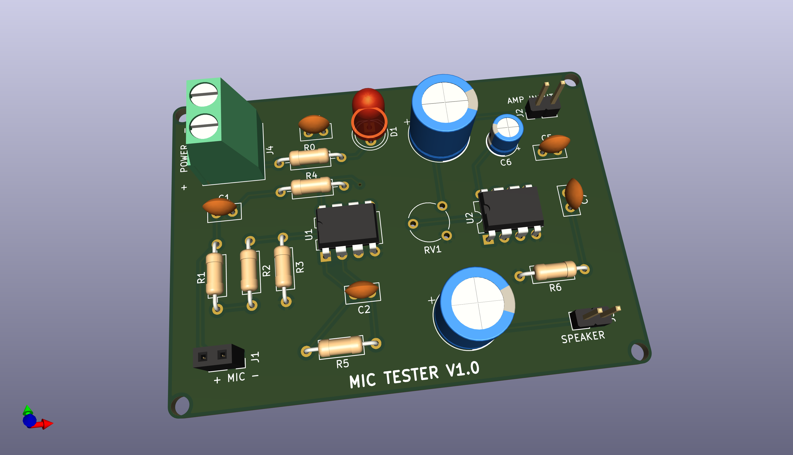
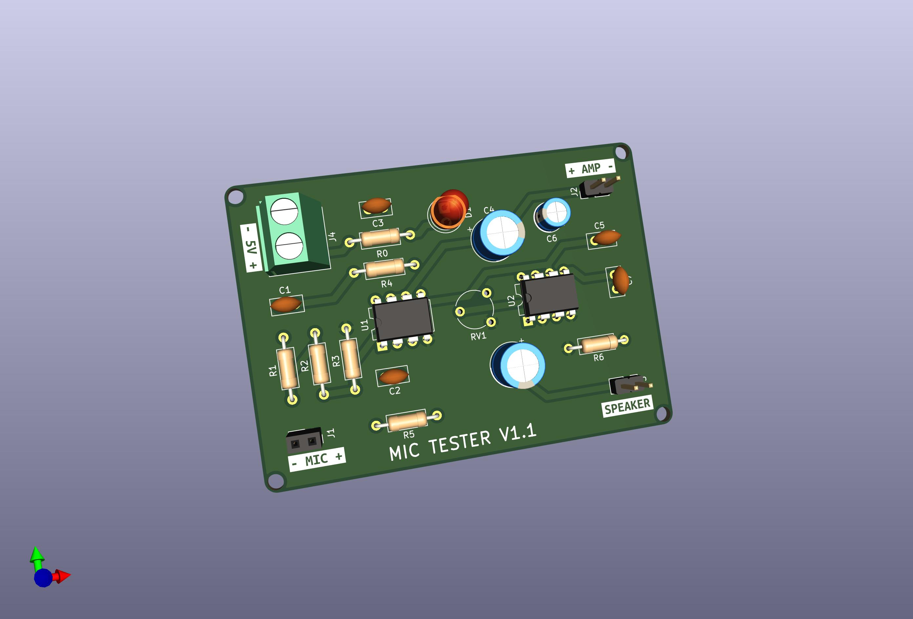

I use KiCad 6.0.1 for this project. All KiCad files are [here](https://github.com/kawashimaken/mic-tester-lm358-lm386/tree/main/mic_tester)

If you want to use PCB service, make sure you export your Gerberfile.

* V1.0 (KiCad 6.0.1) used in the video

* V1.1 (KiCad 6.0.5) not manufactured

# YouTube

  

  

# mic-tester-lm358-lm386

* This repo is for learning purpose!

* The [mic_tester](https://github.com/kawashimaken/mic-tester-lm358-lm386/tree/main/mic_tester) folder contains all files for KiCad.

* Feel free to play with it.

* It will be appriciated if you have any feedback or suggestions to improve it!

# Heavily inspired by the following article

* EC044T-R1
コンデンサーマイク（ECM)
チェッカー：http://www.or2.fiberbit.net/takehiko-inoue01/denshikousaku2013.html#_EC044T-R1

